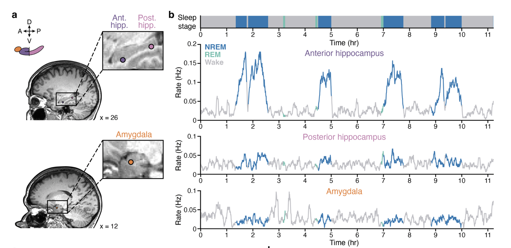

New work from data collected here at Penn, led by an extremely talented graduate student, Liz Siefert, characterizing when ripples occur in humans! [Check out the preprint here](https://doi.org/10.64898/2026.06.26.734578). In short, they used a rigorous ripple detection process to limit false positives, and found that human hippocampal ripples increase in frequency during low-arousal states.

Interestingly, while this was maximally true during NREM sleep, ripples were also more frequent during low-arousal moments of wakefulness, indexed by small pupil size (not an easy measure to collect in the EMU!), and during slow heart rate periods across sleep and wake. I also think it's really exciting that this pattern was strongest in the anterior hippocampus and reversed for ripple-like events in the amygdala. 

This work highlights two things:

1. Rigorous ripple detection matters: verifying that events are true ripples, rather than other high-frequency bursts, recovers the classic pattern of ripples peaking during sleep, which may help explain why some human studies report unexpectedly high ripple rates during tasks.
2. "Offline" states may be better thought of as dips in arousal, which can happen even during active wakefulness. This could reconcile human and rodent findings, and suggests that ripples (and possibly consolidation) are intermixed with ongoing cognition rather than confined to sleep and rest.