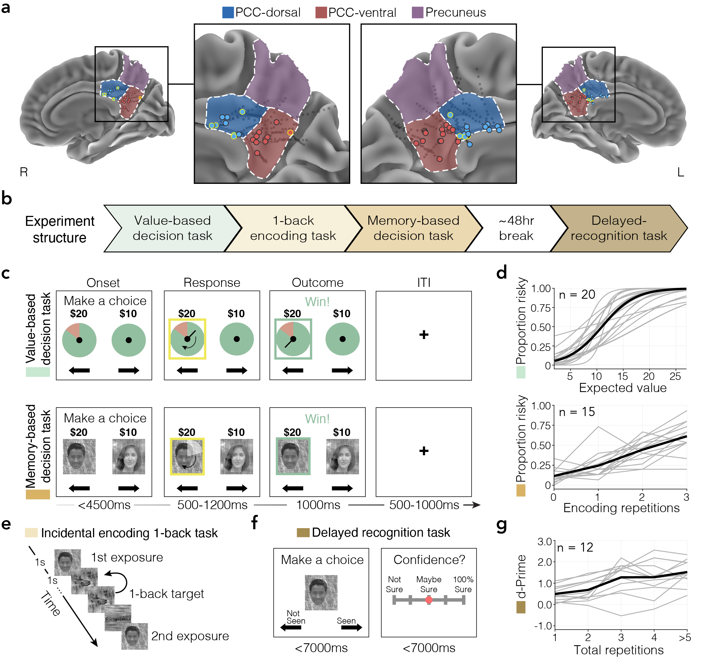

I'm excited that the work I've been doing in the Foster Lab investigating Posterior Cingulate Cortex (PCC) contributions to value- and memory-based decisions has recently been [released as a preprint](https://www.biorxiv.org/content/10.64898/2026.08.12.744505v1) and is out for review. This project was done in collaboration with Baylor College of Medicine and the Medical College of Wisconsin, and builds on the theory of PCC subregional functional neuroanatomy that we have outlined in previous reviews [here](https://doi.org/10.1016/j.cobeha.2025.101560) and [here](https://www.nature.com/articles/s41583-022-00661-x).

In this work, we sought to reconcile seemingly disparate accounts of PCC function derived from non-human primate electrophysiological studies, focusing on the region's role in decision-making, and human neuroimaging, focusing on the region's role in episodic memory as part of the default mode network. To do so, we leveraged the spatiotemporal resolution of intracranial recordings in humans (both local field potentials and single-units) to track PCC subregional engagement during matched risky value- and memory-based decision making tasks. Considering anatomy is one part of the puzzle, as previous work from [our lab](https://www.jneurosci.org/content/44/18/e2220232024.abstract) has demonstrated the dorsal PCC (dPCC) is associated with decision-making, while the ventral PCC (vPCC) is more strongly linked to the retrieval of mnemonic content. Many open questions remain about PCC function. Here we sought to test whether the PCC contributions observed during memory-based decisions would generalize to value-based decisions and whether the temporal engagement of the region would unfold similarly across different decision types. Relatedly, previous research has sometimes associated PCC activity with pre-decision deliberation and other times with post-decision monitoring. Here, we sought to reconcile those accounts. Experiment design and behavior can be seen below (but for the rest of the figures, go read the paper!):

In summary, we observed sustained increases in population-level local field potential (LFP) responses in the dPCC but not vPCC. dPCC responses were similar across both decision-types. Interestingly, across both decisions, LFP responses in dPCC were only modulated by risk-taking or subjective value during the post-response period. We were also able to track single-unit activity from PCC recording sites - finding subpopulations of units that were preferentially engaged either during the pre-response or post-response period. It was really cool to see how this small sampling of units gives us insight into the neuronal populations that may underlie the aggregate population-level response we see in the LFPs! We also sought to contextualize our PCC observations by comparing them to responses in the hippocampus, and found some cool similarities across the regions.

Together, the LFP and single-unit responses suggest that dPCC serves a domain-general role in decision-making, helping reconcile non-human primate electrophysiological and human neuroimaging accounts. Additionally, we demonstrate that PCC contributes to both pre-decision and post-decision processes, so that depending on the exact methods/analysis used the region may be more likely to be implicated in one versus the other. However, this is an early step and more work is to come in precisely characterizing how PCC is involved in helping to guide decision-making in situations where memory is more and less important for optimal behavior.
